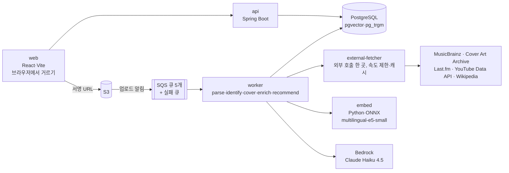

# 결 (gyeol) — 근거와 함께 추천하는 음악 취향 분석

> Analyzes your YouTube listening history and recommends songs that match your taste — with evidence for every pick.

유튜브 청취 기록(Google Takeout)이나 좋아하는 곡 몇 개를 넣으면 취향을 분석하고, **위키백과·MusicBrainz·Last.fm 근거와 함께** 결이 맞는 곡 20곡을 추천합니다.
EKS·AI 경험을 실측 수치와 함께 쌓으려고 만든 사이드 프로젝트입니다.

| 진행 상황 | |
|---|---|
| 로컬 개발 L1~L3 (업로드·통계·곡 식별·RAG 보강·추천·평가) | 완료 |
| 로컬 쿠버네티스(k3d) 배포 검증 | L3-3까지 완료, L3-4·5 확인 예정 |
| AWS EKS (Terraform, 측정하는 날만 올리고 내리는 회차 5번) | 진행 예정 |
| L4 (대화 에이전트, MCP 서버) | 보류 |

## 무엇을 하나

| 입구 | 입력 | 결과 |
|---|---|---|
| A. 곡 고르기 | 곡 3~5개 검색해서 선택 | 추천 20곡과 이유 |
| B. 청취 기록 올리기 | Takeout `watch-history.json` | 통계(곡·가수·시간대·기간) + 취향 요약 + 추천 20곡과 이유 |

- 계정 없이 무작위 토큰 링크로 접근, 즉시 삭제 버튼, 청취 기록 원본 7일·결과 30일 뒤 자동 삭제
- **원본 파일은 서버로 보내지 않습니다.** 브라우저(Web Worker)에서 음악 기록만 골라 올리고, 일반 영상 제목은 서버에 오지 않습니다.

## 구조



**처리 단계** (큐로 이어지고, 3번 실패하면 실패 큐로 보내 진행률이 멈추지 않게 실패로 표시)

1. **거르기** — 브라우저에서 시청 기록 9.6만 건 → 음악 2.5만 건 (0.8초). 애매한 영상은 ID만 보내 YouTube API로 음악 여부 판정
2. **저장** — S3 → 검증 → 한 트랜잭션 저장 (2.5만 건 4.5초) → 기본 통계
3. **곡 식별** — "[MV] 밤편지" 같은 제목을 MusicBrainz 원곡으로. 규칙 → LLM 제목 정리 → 전역 캐시
4. **표지** — 원곡 음반의 앞표지 (다른 음반 표지로 대신하지 않음)
5. **보강 (RAG)** — 위키백과·Last.fm·MusicBrainz 근거 수집 → LLM이 근거 안에서만 곡 설명 → 벡터
6. **추천** — 취향 벡터 → 후보 50곡(Last.fm 두 경로 + 벡터 이웃) → 점수 → LLM 재정렬과 이유 → 검증
7. **평가** — 좋아요·별로, 이유가 틀렸는지 체크 (RAG 켬/끔 블라인드 비교)

## 측정한 수치

| 항목 | 결과 | 비교 기준 |
|---|---|---|
| 곡 식별 정확도 | 28/29 | 정답 세트 29곡 |
| LLM 제목 정리 | 28/28 | 규칙만 4/28 |
| 곡 검색 (초성·오타·붙여쓰기 포함) | 33/33, 가로채기 0/10 | 표본 33개 |
| 같은 곡이 있는 두 번째 세션 식별 | 0.4초 | 전역 캐시 |
| 곡 설명의 근거 일치율 | RAG 켬 80% | RAG 끔 13% |
| 추천 이유 근거 일치 | Haiku 4.5 19/20 | Sonnet 4.6 20/20 (비용 약 3배, 시간 1.6배) |
| 임베딩 (ONNX fp32) | PyTorch와 같은 벡터, 문장당 8.4ms | — |
| 추천 좋아요 비율 (첫 측정, 1세션 20곡) | 75% | RAG 켬 7/10, 끔 8/10 (표본이 작아 차이 없음) |

측정 방법과 한계는 설계 문서의 각 단계 끝에 적었습니다.

## 기술 선택

| 영역 | 선택 | 이유 |
|---|---|---|
| 백엔드 | Kotlin 2.3, Spring Boot 4, JDK 21, Gradle 멀티 모듈 | `core`·`api`·`worker`·`external-fetcher` 분리, worker는 역할(큐)별로 켬 |
| 비동기 | SQS + 실패 큐 | 업로드 폭증·외부 API 한도를 큐 길이로 흡수, 재시도·실패 표시 |
| DB | PostgreSQL 17 + pgvector(HNSW) + pg_trgm + fuzzystrmatch, Flyway | 벡터 검색과 한국어 부분·오타 검색을 한 DB에서 |
| LLM | Bedrock Claude Haiku 4.5, Converse API + tool use | 구조화 출력이 없어 도구 스키마로 받고 자체 검증 |
| 임베딩 | `intfloat/multilingual-e5-small` ONNX (Python·FastAPI) | 다국어, CPU에서 빠름, PyTorch 없이 이미지 경량화 |
| 웹 | React 19, TypeScript, Vite, Web Worker | 큰 파일을 화면 멈춤 없이 브라우저에서 처리 |
| 배포 | Docker, Helm, k3d → EKS (Terraform 예정) | 같은 이미지·차트로 로컬 검증 후 EKS |

## 저장소 구조

```
backend/   core · api · worker · external-fetcher (Kotlin)
embed/     임베딩 서비스 (Python, ONNX)
web/       React 화면
deploy/    Dockerfile, Helm 차트
local/     로컬 PostgreSQL·LocalStack (compose)
scripts/   dev-up/down/status, k3d-up/down, test-all
tools/     가상 Takeout 생성기, 정확도 측정 도구
docs/      설계·결정·측정 기록
```

## 로컬 실행

필요: Docker, JDK 21, Node 22+, [uv](https://docs.astral.sh/uv/)

```bash
cp .env.example .env              # Last.fm·YouTube API 키를 넣는다 (없으면 해당 기능만 동작 안 함)
scripts/dev-up.sh                 # DB·LocalStack + 서비스 전체, 웹 http://localhost:15173
scripts/test-all.sh               # 백엔드·웹·embed 테스트
scripts/k3d-up.sh                 # 로컬 쿠버네티스 배포, http://localhost:18000
```

- 기본은 LLM 가짜 응답(`LLM_MODE=fake`)이라 비용이 들지 않습니다. `LLM_MODE=bedrock`은 AWS 자격 증명이 필요하고 비용이 듭니다.
- 실제 Takeout 없이 시험하려면 `node tools/fake-takeout/generate.mjs`로 가상 파일을 만듭니다 (실제 파일 통계와 2% 안으로 일치).

## 문서

| 문서 | 내용 |
|---|---|
| [docs/design-v3.md](docs/design-v3.md) | 전체 설계: 목표·흐름·데이터 모델·AI·인프라·회차 일정·비용·위험 |
| [docs/l1-design.md](docs/l1-design.md) | L1 업로드·통계·k3d |
| [docs/l2-design.md](docs/l2-design.md) | L2 곡 식별·표지·검색·LLM 제목 정리 |
| [docs/l3-design.md](docs/l3-design.md) | L3 RAG 지식·곡 설명·임베딩·추천·평가와 측정 |
| [docs/testing.md](docs/testing.md) | 자동 테스트와 수동 점검표 |
| [CLAUDE.md](CLAUDE.md) | AI 코딩 도구(Claude Code) 작업 규칙 |

## 외부 데이터

MusicBrainz(CC0), Cover Art Archive, Last.fm API(비상업, 출처 표시), Wikipedia(CC BY-SA), YouTube Data API(음악 여부 판정에만)를 각 약관에 맞게 씁니다. 외부 호출은 `external-fetcher` 한 곳에서 API별 속도 제한(MusicBrainz 초당 1회)을 지킵니다. 가사와 오디오는 다루지 않습니다.

## 라이선스

[MIT](LICENSE)
